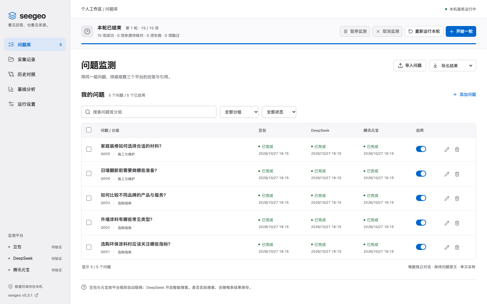
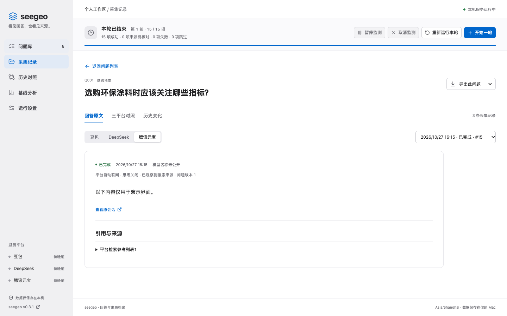
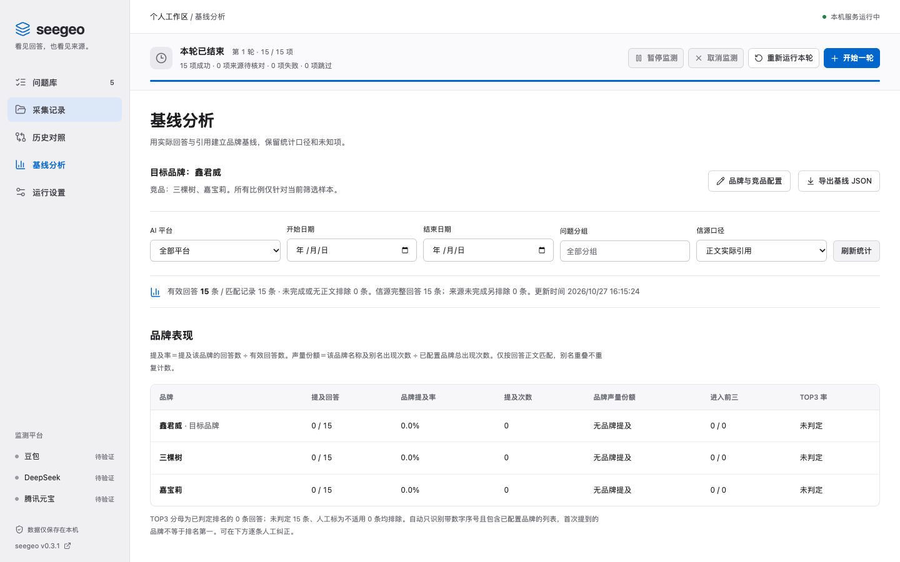
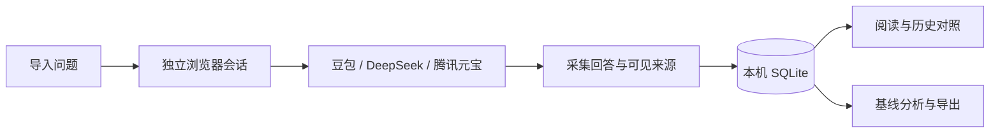

<div align="center">


**在自己的 Mac 上，持续记录 AI 怎么回答、参考了哪些来源。**

[快速开始](#-快速开始) · [界面预览](#-界面预览) · [功能介绍](#-六项核心能力) · [使用手册](docs/guide.md) · [架构说明](docs/architecture.md)


</div>

seegeo 是一个本机 AI 回答监测工具。导入问题后，它使用你登录的官方网页，分别采集**豆包、DeepSeek 和腾讯元宝**的回答与页面可见来源；你可以回看历史、比较变化，并围绕自定义品牌建立分析基线。

> 项目仍在持续验证中。平台页面、搜索行为、登录状态和验证码都可能变化；来源提取不完整的结果会标明「来源待核对」。豆包会分别显示平台报告的参考资料数与实际展开的链接数；正文没有引用时明确标示。大批量长期运行的稳定性尚未充分验证。

## ✨ 六项核心能力

| 能力 | 可以做什么 |
| --- | --- |
| 📚 **问题库** | 多行粘贴或 CSV 导入；编辑、分组、启停及批量移出问题。 |
| 🌐 **三平台采集** | 每题开启独立对话，记录官方网页的回答、可见模型和搜索状态。 |
| 🔎 **回答与来源** | 阅读完整回答，分别查看正文引用和搜索参考列表，并打开原会话核对。 |
| 📊 **基线分析** | 自定义品牌与投放链接；按测试轮次保存提及率、声量份额、TOP3 和来源占比，并对照历史。TOP3仅依据明确排名自动识别。 |
| 🕰️ **历史对照** | 按平台和日期查看记录，对比回答变化及来源增减。 |
| 🛠️ **本机任务管理** | 手动或定时运行、暂停、继续、取消和重跑；一键补采最新未完成任务，导出 CSV / JSON。 |

## 🖥️ 界面预览

以下截图使用独立演示数据，并非真实采集结果。

### 问题库

管理问题、分组和三平台采集状态。



### 回答与来源

阅读采集到的回答，并核对平台展示的来源。



### 基线分析

按平台、时间和分组筛选，用可配置的品牌范围查看统计。



## 🚀 快速开始

**需要：** macOS、Google Chrome、可访问三平台的网络及各平台账号。

1. 下载或克隆本仓库，双击 `Setup.command` 安装依赖并构建。
2. 双击 `Start.command`，打开 [http://127.0.0.1:4317](http://127.0.0.1:4317)。
3. 在「运行设置 → 平台与登录」打开各平台窗口，手动登录。
4. 在「问题库」导入问题，点击「开始一轮」。先用少量问题核对回答和来源，再启用计划监测。

例如，将下面的问题粘贴到导入框，每行一题：

```text
选购环保涂料时应该关注哪些指标？
外墙涂料有哪些常见类型？
如何比较不同品牌的产品与服务？
```

关闭网页不会停止服务；在「运行设置」选择退出服务，或在启动服务的终端按 `Ctrl+C`。首次安装、登录、定时计划、备份和故障处理详见 [使用手册](docs/guide.md)。

任务结束后，可在顶部点击「一键重采未完成」：确认各平台数量后，系统会创建补采批次，优先核对原会话。具体范围见[使用手册](docs/guide.md#一键重采未完成任务)。

## 🔄 工作流程



DeepSeek 显式开启智能搜索；豆包和腾讯元宝使用平台自动联网，是否实际搜索逐条记录。采集使用独立 Chrome 登录目录；验证码由用户处理，超时和来源缺失不会记作完整成功。

## 🔐 数据与统计口径

问题、答案、数据库、登录态和诊断文件默认保存在 `~/Library/Application Support/seegeo/`，不上传到本仓库。导出和备份可能包含敏感信息，请自行妥善保管。

基线按测试轮次保存，保存后即使配置或原始记录变化也不会重算。品牌指标只统计问题不含目标品牌及别名的有效回答：声量份额按品牌名称出现次数计算；TOP3 仅统计可判定的排名，支持人工修正；情感需人工核对。来源网站比例仅使用来源提取完整的回答，正文引用和搜索参考分别统计。在「基线分析 → 投放内容链接库」先维护渠道及文章链接，再选择测试日期，在可收起的问题列表中勾选问题并点击「保存本轮基线」；网站比例默认展示前三项，可展开查看全部；支持修订、多轮对比和 Excel / JSON 导出。正文引用和检索参考分别计算；豆包只保存页面实际展示的链接。工具不统计回答结构比例、不抓取来源文章全文，也不会自动判定事实错误。详见 [指标计算与限制](docs/guide.md#v030基线分析)。

## 🧑‍💻 开发与参考

项目使用 Node.js 24、TypeScript、Playwright、SQLite 和 React。安装 Node.js 24 后：

```sh
npm ci
npm run build
npm test
npm start
```

本项目独立实现，参考 [geo-monitor](https://github.com/eric1981/geo-monitor) 理解平台适配器与历史存储流程。README 的组织参考 [Anthropic 文档写作指南](https://github.com/anthropics/knowledge-work-plugins/blob/main/engineering/skills/documentation/SKILL.md)。欢迎通过 GitHub Issue 提交问题或改进建议；提交代码时请勿包含个人数据、登录态和诊断文件。

[MIT License](LICENSE)
